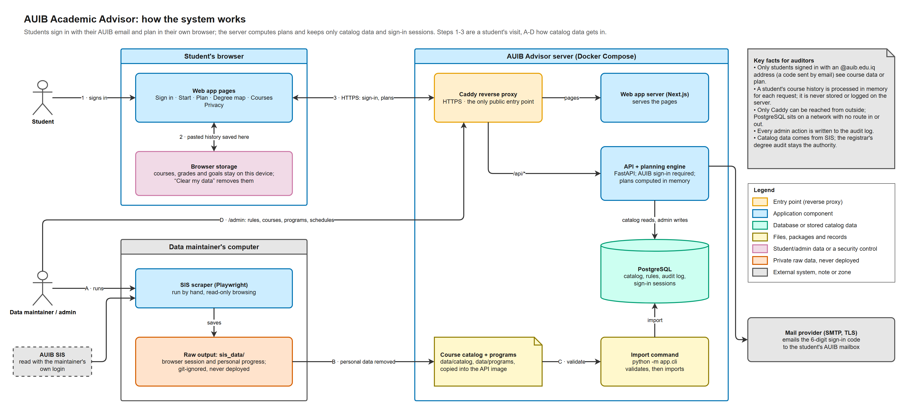
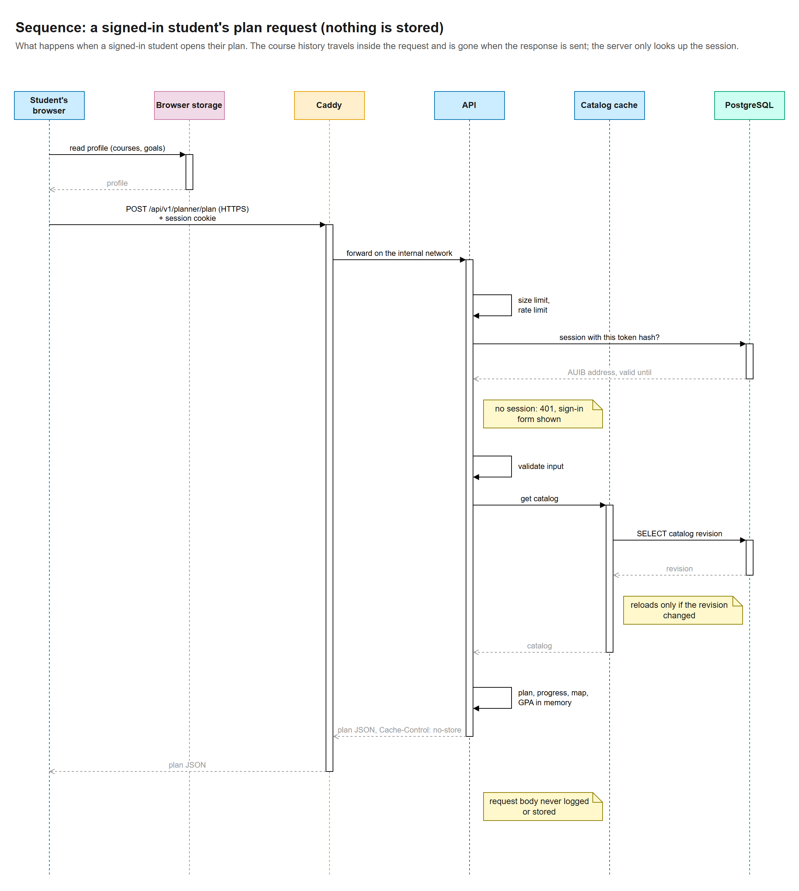
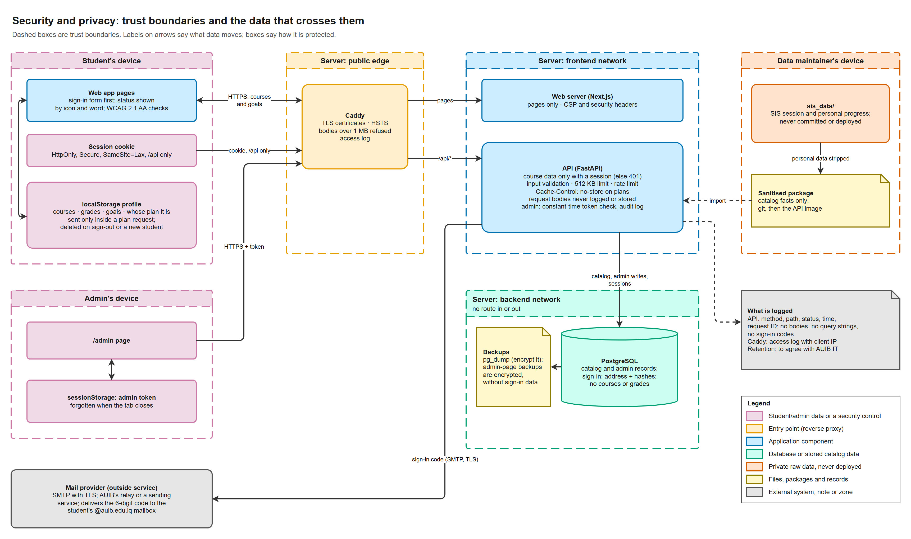

# AUIB Academic Advisor

**A planning tool that shows every AUIB student what to take next, what is left before they graduate,
and what a change of plan would do to their graduation date.**

Students sign in with their AUIB email, paste their Course History from SIS, and get a term-by-term
plan to graduation in about three minutes. Their courses and grades stay on their own device: the
server works out the plan and forgets it immediately.

> The Academic Advisor is a planning aid, not an official degree audit. The registrar's audit in SIS
> always has the final word, and registration still happens in SIS.

---

## Why it matters

### For students

SIS shows requirement groups and course lists, but not the things that decide when you graduate:
which course unlocks which, which courses run only in some terms, and what happens if you drop one.
Students often learn that a course held them back only after it has delayed them by a semester.

The Academic Advisor answers the questions students usually bring to their advisor:

| Question | What the app shows |
| --- | --- |
<<<<<<< HEAD
| Curriculum import from the SIS scraper, with validation (F0.1, F0.6, F0.7) | Done |
| Prerequisite parsing from course descriptions, 343 of 351 CS-catalog rules fully understood (F0.2) | Done |
| Admin review and correction of rules, kept across re-imports, audit log (F0.3, F9.3) | Done |
| Admins and advisors by AUIB email: the master token adds admins, admins add advisors, everyone signs in with an emailed code, and the audit log names each admin (F9.3, part of F9.4) | Done; advisors get their own view later (F5.3) |
| Admin editing: edit, add, bulk-upload (CSV, spreadsheet paste, .xlsx) and hide courses; build, edit and hide majors and minors; edits kept across imports | Done |
| 16 majors: Computer Science from SIS, and Biology, Chemistry, Physics, English Literature, Psychology, International Relations, six Business tracks, Optometry, Anesthesia Technology and Dental Surgery from AUIB's released curricula; Radiologic Sciences, Dental Technology and Pharmacy wait as drafts (F0.6) | Done, to confirm with the colleges |
| Encrypted backup and restore in the admin page (AES-256-GCM, passphrase or generated key); the command line restores too, for moving servers | Done |
| Remaining requirements, eligibility, term-by-term plan, locks (F1.1–F1.6) | Done |
| Drop/delay what-if with graduation impact (F1.5) | Done |
| Move a course to another term by dragging it, or from a "Move to another term" dialog: every term says whether the course fits there and what that does to graduation, and a term where it cannot go says why (F6.1) | Done |
| Save up to 3 plans in the browser and compare them with the current one side by side: graduation, credits left and credits per term (F6.2) | Done |
| Try another major or minor: where each completed course would count, the credits that would no longer count, and the new graduation term; save it to compare or switch to it (F6.3) | Done, rules to confirm with the registrar |
| Courses that count toward the major and the minor, or that two requirements list, are flagged with where they count (F1.7) | Done, SIS allocation to confirm |
| Build the plan one term at a time: add recommended courses or Auto-fill the term, then finish it; later terms stay a folded-away suggestion (F1.9) | Done |
| Quick questions fitted to the major (what the student enjoys, what they would rather avoid, plans after graduating) and explained elective recommendations (F2.1, F2.2) | Done |
| Gateway courses and longest prerequisite chain (F3.2) | Done |
| Degree map: every course by term with prerequisite arrows (F5.1, F5.2) | Done |
| Printable plan for the advisor on A4: the next semester in detail, an optional overview of every term, sign-off area (F5.4) | Done |
| Minors in Psychology and Teaching and Learning Design, planned with the major; shared courses count toward both (F11.2) | Done, TLD lists to confirm with CEHD |
| "Replace with" for courses the student chooses | Done |
| CGPA, last term GPA and retake suggestions; "Plan my grades": the CGPA from expected grades and the grades a target needs (F7.1–F7.3) | Done, rules to confirm with AUIB |
| Requirement versions: each student follows the version of their major in force when they joined AUIB (F0.4) | Done |
| Offering seasons: internships planned in summer only | Done |
| Progress tracking and "what's left" (F4) | Done |
| Sign-in with an AUIB email address and a code sent to it; course and program data only for signed-in students; signing out deletes the plan from a shared computer, or ends every session and the address on the server (F9.1, F9.2) | Done; needs a mail server (AUIB's relay or a sending service) |
| Course History paste, data kept in the browser only (F11.3–F11.5) | Done |
| Per-term course schedules uploaded in the admin page; a term with one plans only its courses, and terms without one are marked "not confirmed" (F0.5, F1.8) | Done |
| Offering history (F3.1, F3.3) | Waiting for registrar data |
| AUIB single sign-on and plans saved to an account (F9.4, F11.6), course requests (F12), reviews (F8) | Next milestones |
=======
| **What should I take next term?** | Recommended courses for your next term, plus every other course you can take then. Add them one by one, or press Auto-fill. |
| **What is left before I graduate?** | Credits completed, in progress and still needed for each requirement, and a "what's left" checklist. |
| **When will I graduate?** | A term-by-term plan to graduation that respects prerequisites and your credit limit. |
| **What if I fail, drop or delay a course?** | The new graduation date and every course that moves as a result. |
| **Can I move this course to another term?** | Drag it to another term. Each term shows straight away whether the course fits there and what that does to your graduation; if it doesn't fit, the app explains why. |
| **Which electives suit me?** | A few quick questions about what you enjoy and what you plan after graduating; every suggestion says why it was suggested. |
| **What if I change my major or add a minor?** | Which of your courses would still count, which would not, and your new graduation date. |
| **Which plan is better?** | Save up to three versions of your plan and compare them side by side. |
| **How is my GPA doing?** | Your CGPA, last term's GPA, the retakes that would raise it most, and the grades you need to reach a target. |
>>>>>>> df1ef15f35ad7ce3166bb1376e6fda9d00abccb7

It also draws your whole degree as a map with prerequisite arrows, warns you about courses that
unlock many others, and flags courses that count toward your major and your minor at the same time.

### For advisors

- **A prepared student.** Students arrive with a plan they have already thought through, so the
  meeting can be about choices instead of looking things up.
- **A printable plan.** "Print for my advisor" produces an A4 document: the next semester in detail
  (courses, credits, the requirement each one counts toward, things to check), an optional overview of
  every term, and a space to sign. It states clearly that an advisor's approval is not a promise that a
  course will be offered.
- **Rules you can check.** Every prerequisite the app uses is shown next to the sentence from the SIS
  course description it came from. Anything unclear (such as "or consent of instructor") becomes a
  visible note, never a silent guess.
- **The right requirements for each student.** Each student is planned against the version of their
  major that applied when they joined AUIB.

<<<<<<< HEAD
```sh
cp .env.example .env        # set POSTGRES_PASSWORD, ADVISOR_ADMIN_TOKEN (the master token), ADVISOR_DATA_KEY and the SMTP settings
docker compose up -d --build
```

The course and program data are only for signed-in AUIB students, so this public repository holds them
sealed (`data/sealed/curriculum.sealed`, [ADR 0008](docs/decisions/0008-sealed-course-data.md)).
`ADVISOR_DATA_KEY`, from the project's maintainers, opens them for the import. The key is optional: without
it the app starts with an empty catalog, and admins add courses and programs in the admin page.

Sign-in codes are emailed, so the API needs an SMTP server that can reach `@auib.edu.iq` mailboxes
(see [docs/operations.md, Mail for sign-in codes](docs/operations.md#mail-for-sign-in-codes)). To try
the app without one, set `ADVISOR_ENVIRONMENT=development` and `ADVISOR_MAIL_MODE=log` in `.env`; the
codes then appear in `docker compose logs api`.
=======
### What it covers today

16 majors (Computer Science, Biology, Chemistry, Physics, English Literature, Psychology,
International Relations, six Business tracks, Optometry, Anesthesia Technology and Dental Surgery) and
the minors in Psychology and in Teaching and Learning Design. More programs can be added from their
data files without changing the app.
>>>>>>> df1ef15f35ad7ce3166bb1376e6fda9d00abccb7

---

## How it works



**A student's visit (steps 1 to 3 in the diagram)**

1. **Sign in.** The student enters their `@auib.edu.iq` address and types the 6-digit code the app
   emails to them. No password is created or stored.
2. **Add courses.** The student pastes their Course History page from SIS. The app reads it, shows
   every course it found so the student can correct anything, and saves the result **in that browser
   only**.
3. **Plan.** Whenever a plan is needed, the browser sends the courses to the server over an encrypted
   connection. The server works out the plan in memory, sends it back and keeps nothing.

**Where the course information comes from (steps A to D)**

The list of courses, prerequisites and degree requirements comes from SIS and from the curricula
AUIB's colleges publish. Before anything is loaded, personal details are removed, so the app's course
data holds only public catalog facts. Every file is checked for errors before it is published, and an
administrator reviews the prerequisite rules. Every administrator change is recorded, and each one
can be undone.

### What happens when a student opens their plan



In plain words: the browser reads the student's courses from its own storage and sends them, together
with the student's sign-in, over HTTPS. The server checks that the student is signed in and that the
request is well formed, works out the plan using the course catalog, and sends the plan back with an
instruction not to cache it. The courses that came in with the request are never written to the
database or to any log.

---

## How secure is it?

The app is built around one idea: **the safest student data is data that is never stored.**

### What the server never keeps

- **Your courses and grades.** They stay in your browser and pass through the server only while your
  plan is being worked out. There is no database table for them, so a breach of the server cannot
  reveal anyone's grades.
- **Your SIS password.** The app never asks for it and never logs into SIS on your behalf.
- **Your name or student ID.** Neither is collected.
- **What you pasted.** The Course History text is read in memory and discarded.

### What the server does keep

| What | Why | For how long |
| --- | --- | --- |
| Your AUIB email address | To know you are signed in | Until you sign out, or 30 days at most |
| A scrambled version (hash) of your sign-in code | To check the code you type | Deleted after a day |
| A scrambled version (hash) of your session | To recognise your browser | Until you sign out, or 30 days at most |
| Basic request records: time, page and result, never what you sent | To keep the service running | As agreed with AUIB IT |

<<<<<<< HEAD
API (from `api/`). The course data is sealed: put the key from the maintainers in `.env` at the repository
root as `ADVISOR_DATA_KEY`, then open it (see [docs/data-pipeline.md](docs/data-pipeline.md)):

```sh
python -m venv .venv && .venv/Scripts/activate        # macOS/Linux: source .venv/bin/activate
pip install -r requirements-dev.txt
python -m app.cli data-unseal                        # write data/ and scripts/curricula/ from the sealed copy
alembic upgrade head                                  # SQLite file by default
python -m app.cli import-all --accept-warnings        # load data/catalog and data/programs
uvicorn app.main:create_app --factory --reload        # http://localhost:8000/api/docs
pytest                                                # 336 tests
ruff check app tests && mypy app
```
=======
Because codes and sessions are stored only as hashes, even a full copy of the database could not be
used to sign in as a student.

### How each part is protected
>>>>>>> df1ef15f35ad7ce3166bb1376e6fda9d00abccb7

| Risk | Protection |
| --- | --- |
| Someone outside AUIB uses the app | Only `@auib.edu.iq` addresses can receive a sign-in code, and all course and planning data needs a signed-in student. |
| Someone guesses a sign-in code | Codes expire after 10 minutes, work only once and stop working after 5 wrong tries. A student can request only a few codes an hour. |
| Someone reads the connection | Every page and request travels over HTTPS (encrypted), and browsers are told to always use it. |
| Someone steals the sign-in cookie | The cookie cannot be read by scripts on the page, is sent only over HTTPS and only to the app's own server, and "sign out on all my devices" ends every session at once. |
| A shared or lab computer | Signing out deletes the plan from that computer (on by default). When a different student signs in, the previous student's plan is deleted first. "Clear my data" deletes everything at any time. |
| Someone floods the service | Every request is size-limited and rate-limited, and every field is checked before it is used. |
| Someone tampers with the course rules | Only administrators can change them, every change goes into an audit log, and changes can be undone. |
| A lost backup file | Backups made from the admin page are encrypted (AES-256) and unreadable without their passphrase. They never contain student courses or grades. |
| The server is broken into | The database sits on a private network that cannot be reached from the internet, and the app runs without administrator rights on the server. |

The diagram below shows every boundary that data crosses and how it is protected at each one:



The code is checked automatically on every change: strict type checking, security-focused linting,
more than 300 automated tests of the planning rules and the server, browser tests that include
accessibility checks (WCAG 2.1 AA), and scans of every third-party library for known vulnerabilities.

### Still to do before a university-wide launch

Being honest about what is not finished yet is part of being secure:

- A security review or penetration test by AUIB IT.
- AUIB single sign-on for students and administrators (administrators currently use a shared token).
- Agreeing with AUIB IT which mail service sends the codes and how long server logs are kept.

<<<<<<< HEAD
Catalog data (courses, requirements) comes from SIS and AUIB's documents and is only for signed-in AUIB
students: the public repository holds it sealed (AES-256-GCM), and the key is kept by the maintainers,
the servers and CI. The raw scraper output in `sis_data/` contains a logged-in browser profile and
personal progress, so it is git-ignored and never copied into an image. Students' course histories are
processed in memory for each request and never stored or logged. The only thing the server keeps about
a student is their AUIB email address while they are signed in, with hashes of their sign-in code and
session. Details are in
=======
The full list of data, controls, threats and open items is in
>>>>>>> df1ef15f35ad7ce3166bb1376e6fda9d00abccb7
[docs/security-and-privacy.md](docs/security-and-privacy.md).

---

## Good to know

- **The plan is advice.** Courses may not run in a given term, may be full, or may change. Terms
  without a published course schedule are marked "not confirmed".
- **In-progress courses are assumed passed.** Use "What if I don't pass?" to see the other case.
- **Some rules still need confirming with AUIB**, such as the grading scale, credit limits and how SIS
  counts a course that fits two requirements. Until then, the registrar's audit decides.

## More information

| For | Read |
| --- | --- |
| How the system is built, with one diagram per part | [docs/system-diagrams.md](docs/system-diagrams.md) |
| Security and privacy in full | [docs/security-and-privacy.md](docs/security-and-privacy.md) |
| Every requirement and its status | [docs/requirements-traceability.md](docs/requirements-traceability.md) |
| The goals and scope of the project | [Project requirements document](AUIB%20Academic%20Advisor%20—%20Project%20Requirements%20Document.md) |
| Running the app or working on its code | [docs/development.md](docs/development.md) |
